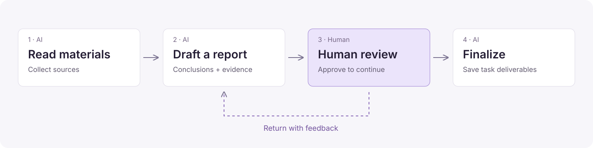

<h1 align="center">dsh-kanban</h1>
<p align="center"><strong>A board for people. Workflows for AI.</strong><br>Plan, run and review work inside DeepSeek Harness.</p>

<p align="center">
  <a href="https://www.npmjs.com/package/@alpacachen/dsh-kanban"></a>
  <a href="https://github.com/alpacachen/dsh-kanban/actions/workflows/ci.yml"></a>
  <a href="LICENSE"></a>
  <a href="https://awesome-dsh-plugin.com"></a>
</p>

<p align="center">
  <a href="README.zh.md">简体中文</a> · <strong>English</strong><br>
  <a href="#get-started">Get started</a> · <a href="#kanban--work-you-lead">Kanban</a> · <a href="#workflow--work-ai-runs">Workflow</a> · <a href="#documentation">Documentation</a>
</p>

One plugin, two ways to work. Use **Kanban** to organize tasks and decide what happens next. Use **Workflow** to give AI a repeatable sequence, follow its execution, and step in at review points.

Both live under **Kanban · Workflow** in the sidebar. Switch modes beside the workspace name; the plugin remembers your last mode and workspace.

| | Kanban · Work you lead | Workflow · Work AI runs |
| --- | --- | --- |
| Start with | A task or a plan from a conversation | A reusable process designed with your Agent |
| Move forward | You or your Agent update cards | AI executes stages in order |
| Keep control | Priorities, deadlines and review columns | Human approval, feedback, retry and stop |
| Keep the context | Descriptions, screenshots, comments and activity | Stage conversations, reports and task-specific files |

## Get started

Requires **DSH 0.2.2-rc.3**, with desktop and Web support. For Workflow, configure an execution model in DSH first.

**Desktop** — Open **Plugins**, add `@alpacachen/dsh-kanban`, and enable it.

**Web** — Install the plugin, then restart your Web instance to load it:

```sh
dsh plugin --profile web add @alpacachen/dsh-kanban
```

Open **Kanban · Workflow** in the sidebar and choose a workspace. Stay in **Kanban** to create your first card, or switch to **Workflow**, choose **Create workflow in chat**, and describe a process.

> Workflow is included in **1.12.0**. Until that release is published, installing from npm gives you the latest published version. To try this branch, [build and install it locally](docs/testing-images.md#local-workflow-build).

## Kanban — Work you lead

Turn plans into visible tasks. Move cards yourself, ask your Agent to keep them up to date, and take the next step when you are ready.


<sub>Actual plugin UI with isolated example data. Each workspace has its own board.</sub>

- **Plan together.** Ask your Agent to break down a goal, write acceptance criteria and create cards with 19 built-in board tools.
- **Find the next task.** Search titles, descriptions, comments and IDs; combine priorities, labels and due-date filters.
- **Keep evidence close.** Add Markdown, screenshots, comments and activity history to a card.
- **Continue in chat.** Bring a card and its saved images into a new conversation as an editable draft, ready for you to send.

Try asking your Agent:

> Break phone sign-in into testable tasks. Check existing cards first to avoid duplicates. Add implementation steps and acceptance criteria, and mark launch blockers as P0.

[Kanban guide →](docs/guide.md) · [All 19 board tools →](docs/guide.md#agent-tool-reference)

## Workflow — Work AI runs

Describe a process once, then give it new inputs. AI runs its stages using DSH's normal tools and authorization; you can follow the work and decide at human review points.

<picture>
  <source media="(max-width: 600px)" srcset="docs/readme/workflow-en-mobile.svg">
  
</picture>

<sub>An example process. Human review pauses execution until you approve, return it with feedback, or stop.</sub>

### Design it in conversation

Ask your Agent to create or revise a workflow. It saves the stages, instructions, deliverables and review points. New AI stages inherit the model used in that conversation; you can later edit stage instructions and choose a model and reasoning effort in the stage dialog.

> Create a reusable research workflow: read the materials, draft a report with sources and open questions, wait for my review, then finalize the report. If I return it, go back to drafting. Save the workflow without running a task.

### Run it with a new input

Expand a workflow in the home list and choose **Create task**. Enter what you need and send it. No separate task name or model setup is required.

- **See the work.** The diagram highlights the current stage. Click a stage to inspect its native DSH conversation, available reasoning text, tool calls and replies.
- **Review and revise.** Approve to continue or return with feedback. Earlier reports and review decisions remain available.
- **Keep files separate.** Every task has its own output directory, shared by its stages. Preview files in place, open the directory, or delete deliverables with confirmation.
- **Resume deliberately.** Retry a failed stage after checking the cause. After a crash, reconcile the old execution before retrying; completed upstream stages are retained.

### Improve the process from its history

Choose **Optimize from history** to start a conversation with an analysis prompt. The Agent can inspect previous task results, review feedback, stage conversations and recorded timings. Changes apply to future tasks; existing tasks keep their original workflow version.

[Workflow guide →](docs/workflow-guide.en.md) · [Agent interface (中文) →](docs/workflow-agent-interface-review.md) · [Validation and recovery boundaries (中文) →](docs/workflow-validation.md)

## What to expect

- **Native DSH execution.** Workflow adds orchestration and human review, with no separate tool-permission system or extra model-turn, tool-call or stage-time budgets.
- **Sequential stages.** Stages in a task run in order. Tool concurrency and model-request retries follow DSH; a failed workflow stage is retried by you.
- **Small handoffs.** Stages receive upstream conclusions, evidence references and a file index. Full reports are read when needed instead of carrying the entire conversation forward.
- **Review scope is explicit.** Approval applies to the saved stage reports. It does not snapshot project files or undo changes made by tools.
- **Two interface languages.** Controls, owned error messages and dates follow DSH's Chinese or English setting. Your inputs, prompts and saved outputs retain their original language.

If DSH is forcibly killed, previously launched commands can survive on macOS. Check that old commands and external operations have stopped before confirming recovery. The plugin will not silently rerun an interrupted stage.

## Documentation

| You want to… | Read |
| --- | --- |
| Use cards, search, images and chat handoff | [Kanban guide](docs/guide.md) |
| Create, run, review and improve workflows | [Workflow guide](docs/workflow-guide.en.md) |
| Understand board tools | [Board tool reference](docs/guide.md#agent-tool-reference) |
| Back up your data | [Kanban data](docs/guide.md#data-and-backups) · [Workflow data](docs/workflow-guide.en.md#data-and-backups) |
| Build and validate the plugin | [Development checks](docs/testing-images.md) · [Workflow acceptance record](docs/workflow-validation.md) |
| Report a problem or suggest a change | [GitHub Issues](https://github.com/alpacachen/dsh-kanban/issues) |

---

[MIT](LICENSE) · Built for DeepSeek Harness
