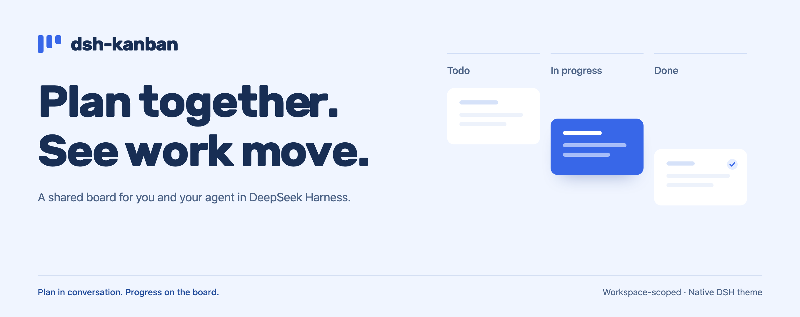
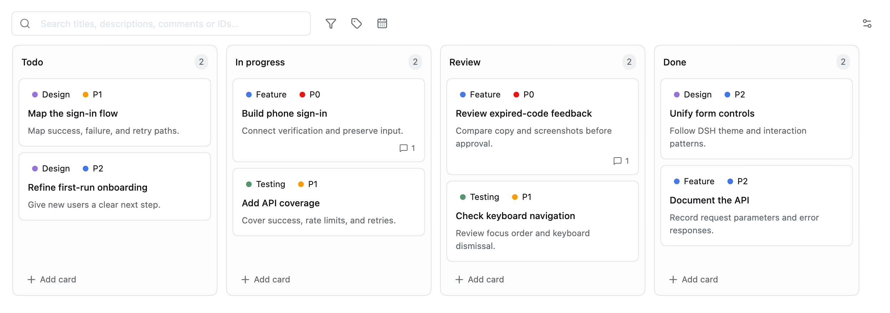

<p align="center">
  <picture>
    <source media="(max-width: 600px)" srcset="docs/readme/cover-en-mobile.png">
    
  </picture>
</p>

<p align="center">
  <a href="https://www.npmjs.com/package/@alpacachen/dsh-kanban"></a>
  <a href="LICENSE"></a>
  <a href="https://awesome-dsh-plugin.com"></a>
</p>

<p align="center">
  <a href="README.zh.md">简体中文</a> · <strong>English</strong><br>
  <a href="#get-started">Get started</a> · <a href="docs/guide.md">User guide</a> · <a href="docs/guide.md#agent-tool-reference">Agent tools</a>
</p>

<br>

Turn plans from your conversations into tasks you can move forward. You and your agent share one board for planning, context, and progress, all inside DeepSeek Harness.



<p align="center"><sub>Current plugin UI · Isolated demo data · A separate board for every workspace</sub></p>

## From a conversation to the next step

### Describe the goal. Let your agent create the tasks.

Ask your agent to break down a requirement, write implementation steps and acceptance criteria, and assign labels and priorities. With 19 built-in tools, the plan goes straight onto the board.

> Break phone sign-in into testable tasks. Check existing cards first to avoid duplicates. Write implementation steps and acceptance criteria for each card, and mark launch blockers as P0.

### See the progress. Take over at any time.

Drag cards between stages, then use search and filters to find the next task. Markdown descriptions, comments, and activity history keep the work's context in one place.

| What matters | How to find it |
| --- | --- |
| Important work | P0 / P1 / P2 priorities and custom labels |
| Upcoming deadlines | Due dates, due-today and overdue filters |
| Existing decisions | Search card IDs, titles, full descriptions, and comments |

### Bring the context back into conversation.

Paste or drop screenshots into a task, then choose **Create new conversation** to bring its text and saved images into a new conversation in the selected workspace. Everything starts as an editable draft for you to review and send.

[Image and saving rules →](docs/guide.md#usage-details) · [More prompt examples →](docs/guide.md#prompt-examples)

## Get started

**Desktop** — Open **Plugins**, add `@alpacachen/dsh-kanban`, and enable it.

**Web** — Run the command below, then restart `dsh web` to load the plugin.

```sh
dsh plugin --profile web add @alpacachen/dsh-kanban
```

Open **Board** in the upper-left sidebar, then click the workspace name at the top to switch boards. Start with four default stages:

**Todo → In Progress → Review → Done**

Requires DSH **0.2.2-rc.3**, on Web and desktop. Upgrade DSH before installing Kanban 1.11.3.

<details>
<summary>Check the Web plugin configuration</summary>

```sh
dsh --profile web --dump-config
```

Look for a `dsh-kanban` layer. Its presence confirms the configuration, not that the running service has loaded it; restart the Web service after installation.

</details>

## Explore further

- [User guide](docs/guide.md) — Editing, search, images, and collaboration.
- [Agent tool reference](docs/guide.md#agent-tool-reference) — All 19 tools, arguments, and completion rules.
- [Data and backups](docs/guide.md#data-and-backups) — Keep both the board file and the DSH attachment store to preserve images.
- [Development and validation](docs/testing-images.md) — Node.js 26, pnpm 11.8.0, builds, and tests.
- [Issues and ideas](https://github.com/alpacachen/dsh-kanban/issues) — Report a problem or share feedback.

---

[MIT](LICENSE) · Built for DeepSeek Harness
