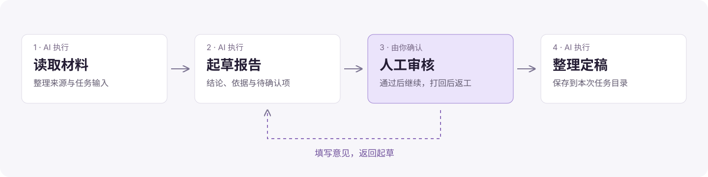

<h1 align="center">dsh-kanban</h1>
<p align="center"><strong>面向人的看板，面向 AI 的工作流。</strong><br>在 DeepSeek Harness 中规划、执行与审核工作。</p>

<p align="center">
  <a href="https://www.npmjs.com/package/@alpacachen/dsh-kanban"></a>
  <a href="https://github.com/alpacachen/dsh-kanban/actions/workflows/ci.yml"></a>
  <a href="LICENSE"></a>
  <a href="https://awesome-dsh-plugin.com"></a>
</p>

<p align="center">
  <strong>简体中文</strong> · <a href="README.md">English</a><br>
  <a href="#开始使用">开始使用</a> · <a href="#kanban面向人的看板">Kanban</a> · <a href="#workflow面向-ai-的工作流">Workflow</a> · <a href="#文档导航">文档</a>
</p>

一个插件，两种工作方式。用 **Kanban** 安排任务、掌握进度、决定下一步；用 **Workflow** 把可重复的步骤交给 AI，查看执行过程，在需要判断的地方参与审核。

两种功能共用侧边栏的 **「看板·工作流」** 入口，在工作区名称右侧切换；插件会记住上次打开的模式和工作区。

| | Kanban · 由你推进 | Workflow · 由 AI 执行 |
| --- | --- | --- |
| 从哪里开始 | 一项任务，或对话中拆解出的计划 | 与 Agent 一起设计的可复用流程 |
| 怎么推进 | 你或 Agent 更新卡片 | AI 按阶段依次执行 |
| 怎么掌控 | 优先级、截止日期、验收列 | 人工审核、反馈、重试与终止 |
| 留下什么 | 描述、截图、评论与活动记录 | 阶段会话、报告与任务独立产物 |

## 开始使用

需要 **DSH 0.2.2-rc.3**，支持桌面端与 Web。使用 Workflow 前，先在 DSH 中配置可用模型。

**桌面端** — 打开「插件」，添加并启用 `@alpacachen/dsh-kanban`。

**Web** — 安装插件后，重启 Web 实例以加载：

```sh
dsh plugin --profile web add @alpacachen/dsh-kanban
```

打开侧边栏的 **「看板·工作流」**，选择工作区。在 **Kanban** 中创建第一张卡片，或切到 **Workflow**，点击「对话创建流程」，描述你希望重复执行的工作。

> Workflow 随 **1.12.0** 提供。在该版本发布前，npm 安装得到的仍是当前已发布版本；尝试本分支请[本地构建安装](docs/testing-images.md#local-workflow-build)。

## Kanban：面向人的看板

把计划变成看得见的任务。自己拖动卡片，也可以让 Agent 整理和更新，下一步由你决定。


<sub>插件真实界面，使用隔离示例数据。每个工作区有独立看板。</sub>

- **一起规划。** 让 Agent 拆解目标、写验收标准，用 19 个看板工具直接创建卡片。
- **找到下一件事。** 搜索标题、描述、评论和 ID，组合优先级、标签与截止日期筛选。
- **上下文留在任务里。** Markdown、截图、评论和活动记录，放在同一张卡片中。
- **带着任务继续聊。** 把卡片文字和已保存的图片带入新会话草稿，检查后再发送。

可以这样告诉 Agent：

> 把手机号登录拆成可验收的任务，先检查已有卡片，避免重复。每张卡写清实现步骤和验收标准，把上线阻塞项标为 P0。

[看板使用指南 →](docs/guide.zh.md) · [全部 19 个看板工具 →](docs/guide.zh.md#agent-工具参考)

## Workflow：面向 AI 的工作流

把方法设计一次，再交给它不同的输入。AI 沿用 DSH 原有工具和授权执行各阶段；你能查看工作过程，也能在人工节点决定是否继续。

<picture>
  <source media="(max-width: 600px)" srcset="docs/readme/workflow-zh-mobile.svg">
  
</picture>

<sub>示例流程。到达人工审核点会暂停，等待你通过、填写意见打回，或终止任务。</sub>

### 在对话中设计方法

让 Agent 创建或修改流程，保存阶段、执行要求、交付结果和审核点。新增 AI 阶段继承当时聊天的模型配置；之后可以在阶段弹窗中编辑执行文本，选择模型与推理档位。

> 帮我创建一个可复用的资料研究流程：先读取材料，再起草带来源和待确认问题的报告，等我审核，通过后整理定稿；打回时回到起草阶段。只保存流程，先不要运行任务。

### 输入任务，查看执行

在首页展开工作流，点击「创建任务」，输入本次需要完成的内容即可发送，无需另填任务名称或选择模型。

- **看见工作过程。** 流程图高亮当前阶段，点击节点查看 DSH 原生会话中可见的思考文本、工具调用与回复。
- **审核与返工。** 通过后继续，填写意见后打回；之前的报告和审核决定仍然保留。
- **产物互不混杂。** 每个任务拥有独立目录，同一任务的各阶段共用；可原地预览、打开目录，或确认后删除产物。
- **确认后再恢复。** 失败后先核对原因，再重试当前阶段；异常退出后先核对旧执行，上游已完成阶段保留。

### 用历史任务改进方法

点击「根据历史优化」，带着预置分析要求进入新对话。Agent 可以读取历史结果、审核意见、阶段会话与已记录的耗时来改进流程。修改只影响未来的新任务，已有任务继续使用原流程版本。

[工作流使用指南 →](docs/workflow-guide.md) · [Agent 接口说明 →](docs/workflow-agent-interface-review.md) · [验收记录与恢复边界 →](docs/workflow-validation.md)

## 运行方式

- **复用 DSH。** Workflow 负责调度与人工审核，不另设工具权限，也不增加模型轮数、工具次数或阶段时长预算。
- **阶段依次执行。** 同一任务按流程顺序推进。工具并发与模型请求重试沿用 DSH；失败阶段由你选择重试。
- **简短交接。** 阶段之间传递上游结论、依据位置和产物索引，需要时再读完整报告，不反复携带整段聊天。
- **审核对象明确。** 通过针对当前保存的阶段报告，不会为项目文件生成快照，也不会撤销工具已经做出的改动。
- **中英文界面。** 控件、内置错误提示和日期跟随 DSH 语言；任务输入、阶段要求和历史产物保持原文。

macOS 上强杀 DSH 后，先前启动的命令可能继续运行。恢复前需要核对旧命令及外部操作已停止；插件不会静默重跑中断阶段。

## 文档导航

| 想了解什么 | 阅读 |
| --- | --- |
| 卡片、搜索、图片与对话交接 | [看板指南](docs/guide.zh.md) |
| 创建、执行、审核和优化流程 | [工作流指南](docs/workflow-guide.md) |
| Agent 如何管理看板 | [看板工具参考](docs/guide.zh.md#agent-工具参考) |
| 备份数据 | [看板数据](docs/guide.zh.md#数据与备份) · [工作流数据](docs/workflow-guide.md#数据与备份) |
| 开发与验证 | [开发检查](docs/testing-images.md) · [工作流验收记录](docs/workflow-validation.md) |
| 问题与建议 | [GitHub Issues](https://github.com/alpacachen/dsh-kanban/issues) |

---

[MIT](LICENSE) · 为 DeepSeek Harness 构建
