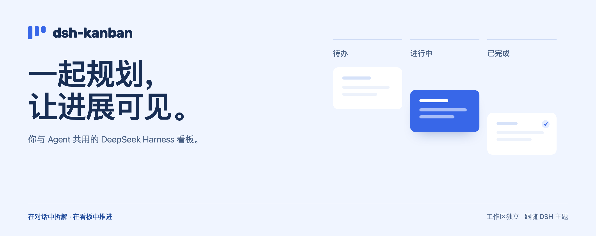
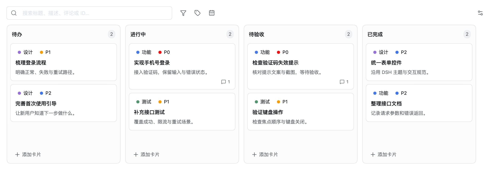

<p align="center">
  <picture>
    <source media="(max-width: 600px)" srcset="docs/readme/cover-zh-mobile.png">
    
  </picture>
</p>

<p align="center">
  <a href="https://www.npmjs.com/package/@alpacachen/dsh-kanban"></a>
  <a href="LICENSE"></a>
  <a href="https://awesome-dsh-plugin.com"></a>
</p>

<p align="center">
  <strong>简体中文</strong> · <a href="README.md">English</a><br>
  <a href="#开始使用">开始使用</a> · <a href="docs/guide.zh.md">使用指南</a> · <a href="docs/guide.zh.md#agent-工具参考">Agent 工具</a>
</p>

<br>

把对话里的计划变成可推进的任务。你和 Agent 在同一块看板上拆解工作、补充上下文、更新进度，始终留在 DeepSeek Harness 中。



<p align="center"><sub>当前插件界面 · 隔离示例数据 · 每个工作区独立保存</sub></p>

## 从一句话，到下一步行动

### 说清目标，Agent 来建卡

让 Agent 拆解需求，写下实现步骤与验收标准，安排标签和优先级。19 个内置工具，让规划直接落到看板上。

> 把手机号登录拆成可验收的任务，先检查已有卡片，避免重复。每张卡写清实现步骤和验收标准，把上线阻塞项标为 P0。

### 看清进展，随时接手

拖动卡片调整阶段，用搜索和筛选找到下一件事。任务描述支持 Markdown，评论和活动记录留下推进过程。

| 关注什么 | 怎么找到 |
| --- | --- |
| 重要的事 | P0 / P1 / P2 优先级与自定义标签 |
| 快到期的事 | 截止日期、今天到期与逾期筛选 |
| 已有的结论 | 搜索卡片 ID、标题、完整描述和评论 |

### 带上上下文，继续对话

把截图粘贴或拖进任务，点击「创建新对话」，将任务文字和已保存的图片一起带到所选工作区的新会话。内容先进入可编辑草稿，由你确认发送。

[查看图片与保存规则 →](docs/guide.zh.md#使用规则) · [更多对话示例 →](docs/guide.zh.md#对话示例)

## 开始使用

**桌面端** — 打开「插件」，添加并启用 `@alpacachen/dsh-kanban`。

**Web** — 运行以下命令，安装后重启 `dsh web` 以加载插件。

```sh
dsh plugin --profile web add @alpacachen/dsh-kanban
```

点击左上角的 **「看板」**，点击顶部工作区名称切换看板，即可从四个默认阶段开始：

**Todo → In Progress → Review → Done**

兼容声明：DSH **0.2.0-rc.2 / 0.2.1-rc.3 / 0.2.2-rc.1**，支持 Web 与桌面端。1.10 依赖新版图片预览与对话附件接口，0.1.5 用户需先升级。

<details>
<summary>确认 Web 插件配置</summary>

```sh
dsh --profile web --dump-config
```

输出中应包含 `dsh-kanban` 配置层。配置存在不代表当前服务已加载，安装后仍需重启 Web 服务。

</details>

## 继续了解

- [使用指南](docs/guide.zh.md) — 编辑、搜索、图片与协作。
- [Agent 工具参考](docs/guide.zh.md#agent-工具参考) — 全部 19 个工具、参数与完成状态规则。
- [数据与备份](docs/guide.zh.md#数据与备份) — 图片备份需同时保留看板文件和 DSH 附件存储。
- [开发与验证](docs/testing-images.md) — Node.js 26、pnpm 11.8.0，构建和测试说明。
- [问题与建议](https://github.com/alpacachen/dsh-kanban/issues) — 提交问题或分享使用反馈。

---

[MIT](LICENSE) · 为 DeepSeek Harness 构建
