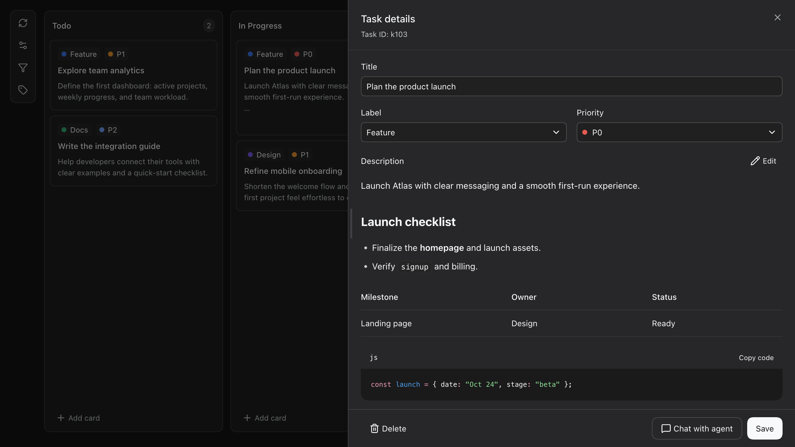

# User guide

[Back to README](../README.md) · [简体中文](guide.zh.md)

## Using the board

Open **Kanban · Workflow** in the upper-left sidebar and click the workspace name at the top to switch boards. The board remembers your selection. Switching workspaces does not create or navigate to a conversation; each workspace keeps its own board.

| Action | How it works |
| --- | --- |
| Find tasks | Search card IDs, titles, descriptions, and comments; the three adjacent buttons filter by priority, label, and due date. |
| Manage the board | **Settings** at the top right contains refresh, column editing, label editing, and **Feedback · GitHub**. |
| Move work forward | Create, edit, delete, and drag cards; add color-coded labels and P0 / P1 / P2 priorities. |
| Read task details | A resizable side drawer remembers its width and fills narrow screens; descriptions support Markdown editing and preview. |
| Attach images | Choose files, paste from the clipboard, or drag images in; see counts on cards and preview, remove, or retry in task details. |
| Track dates | Set due dates, find tasks due today or overdue, and record completion dates automatically when cards enter the completion column. |
| Collaborate | Exchange comments, inspect the activity timeline, or continue a task in a new conversation in the selected workspace. |

Click **Save** to apply text and Markdown edits; **Done editing** only switches back to preview. Active filters appear below the toolbar. Remove a filter with its × button or choose **All** in its menu.

### Continue any card with your agent

Open a card and choose **Create new conversation**. dsh-kanban carries its ID, title, label, due date, and notes into a new conversation in the selected workspace, without reusing an existing blank session. Saved images are also added to the target composer as previewable, removable attachments. Text and images remain an editable draft until you choose to send it. An image-read failure keeps the task dialog open with an error for retry.

<details>
<summary>Earlier dark-mode and Markdown task details</summary>



Interface example captured in an earlier version.

</details>

## Prompt examples

Start with work you actually need to move forward. Replace the project names and context below with your own, then send the prompt to your agent.

**Turn a requirement into tasks with clear acceptance criteria**

> We need to ship phone-number sign-in next week. Check the existing cards, then create tasks for any missing API, verification code, abuse prevention, UI, and testing work. Record dependencies and use Markdown descriptions for implementation steps and acceptance criteria. Mark launch blockers as P0 and prioritize the remaining work.

**Pick up work already in progress**

> Continue “Redirected back to login after signing in.” Read the full description and comments, summarize what we know and the next step, and move it to In Progress. Record progress and test results in comments, then move it to Review for me to verify.

<details>
<summary>More examples: blockers, weekly meetings, and custom workflows</summary>

**Track work blocked on someone else**

> “Payment integration” is waiting for a test account from the provider. Create a Blocked list if needed and move the card there. Add a comment with the blocker, the contact we still need to confirm, and what to do once the account arrives.

**Prepare a weekly meeting from the board**

> Use the current card statuses, descriptions, and comments to prepare our meeting notes: completed work, work in progress, and blockers that need coordination. Reference the relevant cards and suggest the three most useful next actions. Flag missing information as questions to resolve.

**Build a workflow for your profession**

> I'm a lawyer handling contract reviews and case preparation. Set up suitable stages and labels, then create cards for the matters I provide below. Record deliverables, required documents, and agreed dates in each description. Put matters with missing documents in “Waiting for documents.”

</details>

## Usage details

<details>
<summary>Search scope, image limits, and saving behavior</summary>

### Search tasks

Search covers the current workspace's card ID, title, complete description, and comment text. It matches a literal substring, ignores case and surrounding whitespace, and combines with all active filters using AND. It preserves card order and resets when switching workspaces. The agent uses the same search through `kanban_get` with `{"query":"login"}`.

### Add and preview images

Images support PNG, JPEG, and WebP, up to 10 MiB each and 10 images per card; the DSH Host can impose stricter format or size limits. In a new card, selected images stay in the browser until **Save** creates the card. If an upload fails, the created card and successful images remain saved, and the drawer keeps failed files for retry without creating another card. Canceling before creation uploads nothing. For an existing card, image uploads and removals save immediately; text edits still require **Save**. Unsupported Hosts or workspaces that cannot persist data show an upload-unavailable message.

Click a thumbnail to open DSH's native full-size preview. Escape, the close button, or the backdrop returns to task details. Image contents are not included in text search; OCR is not supported.

</details>

## Data and backups

Each card has an `images` array containing only `attachmentId`, `mediaType`, `bytes`, `width`, and `height` per image. Names and captions are not saved. Schema v6 adds `images: []` to existing cards and backs up the old board file before migration. The workspace's `.dsh-kanban.json` holds image references; image files live in DSH's native attachment store under its DSH home, shared independently of a particular workspace or conversation. Back up both the board file and the DSH attachment store to preserve images. Removing an image or card removes the association, not the shared image object.

## Agent tool reference

The plugin gives the agent 19 tools in every workspace:

| Area | Tools |
| --- | --- |
| **Board** | `kanban_get`, `kanban_set_completed_column` |
| **Cards** | `kanban_get_card`, `kanban_add_comment`, `kanban_add_card`, `kanban_update_card`, `kanban_delete_card`, `kanban_move_card` |
| **Images** | `kanban_add_image`, `kanban_read_image`, `kanban_remove_image` |
| **Lists** | `kanban_add_column`, `kanban_rename_column`, `kanban_delete_column`, `kanban_move_column` |
| **Labels** | `kanban_get_label`, `kanban_add_label`, `kanban_update_label`, `kanban_delete_label` |

<details>
<summary>Image arguments and access scope</summary>

For images, create the card first and use the returned `cardId` as `id`. Call `kanban_add_image` with one of these argument objects:

```json
{"id":"k1","source":{"kind":"workspace_file","path":"screenshots/login.png"}}
```

```json
{"id":"k1","source":{"kind":"session_attachment","attachmentId":"sha256:<actual attachment hash>"}}
```

The file path must be relative to the current workspace and stay inside it. A session attachment must actually belong to the executing agent's current session; use its real ID, not a fabricated hash. Do not pass base64 or a remote URL. Repeating the same image does not create another association. `kanban_get` returns image counts; `kanban_get_card` returns the five-field references. Use `kanban_read_image` with `{"id":"k1","attachmentId":"sha256:<actual attachment hash>"}` to inspect pixels, or `kanban_remove_image` with the same arguments to detach it. Both verify that the image belongs to that card in the current workspace.

</details>

<details>
<summary>Markdown descriptions, due dates, and completion</summary>

For `kanban_add_card` and `kanban_update_card`, the task description uses the existing `note` field: send raw Markdown with line breaks, not HTML. Headings, lists, tables and fenced code blocks are rendered in task details. Keep the source within 2,000 characters, including Markdown syntax and newlines; longer input is truncated with a warning. Before editing a description, read `kanban_get_card` for its complete Markdown source (`kanban_get` only returns a summary). Updating `note` replaces the whole description; omit it to preserve the current text, or pass an empty string to clear it. Comments remain plain text.

For due dates, `kanban_add_card` and `kanban_update_card` accept `dueDate` as a real calendar date in `YYYY-MM-DD` format. Omit it to keep the current date (new cards default to none); use `null` or an empty string to clear it. Dates have no time or timezone: a task due today becomes overdue the next local calendar day. Resolve phrases such as “this Friday” against the user's local date and confirm the concrete date instead of sending relative text or a UTC timestamp. Both `kanban_get` and `kanban_get_card` return the date and the board's `completedColumnId`.

Completion dates are recorded automatically when a card enters the configured completion list (including creation there). Reopening clears the date; completing again records a new timestamp. Edits, comments, same-list sorting, and column renames/reordering preserve it. Card details show the local completion time next to the due date; it is read-only. Both read tools return `completedAt` as a UTC ISO timestamp, or `null`. A completed card with `null` has an unknown completion time. Changing or clearing the completion list resets completion dates; existing cards in the newly selected list have unknown dates. Deleting a list applies the same completion rules to its automatic card moves. When upgrading from a schema older than v5, historical completion times remain unknown rather than being inferred from the activity log.

Use `kanban_set_completed_column` with an existing `columnId` to designate the finished stage, or `null` to clear it. New boards use their default Done column; existing boards need an explicit choice. Completion follows the column ID through renames and reordering, and deleting that column clears the setting. Cards in the completion column keep their dates but are excluded from **Due today** and **Overdue** filters; moving them out resumes date checks. There are no automatic reminders or date-based reordering.

> Set the payment integration task's due date to this Friday, then show me unfinished tasks that are due today or overdue so I can decide what to tackle first.

</details>

